# The Forgotten Archive — AI Escape Room

**Deep Learning & Generative AI mini-project** · Python · Gemini · Streamlit · Blender

You awaken inside a locked Gothic archive. An experimental AI named ECHO guides you as you investigate mysterious objects, decipher clues, collect items and unlock the exit. Two implementations demonstrate the difference between LLM-managed gameplay and a reliable, Python-validated game engine.

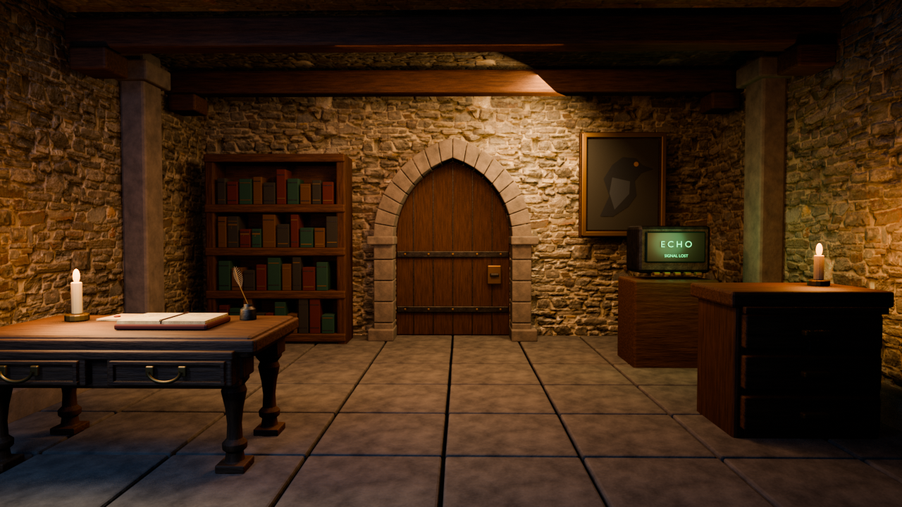

## Play the game

| Version | Launch locally | Purpose |
| --- | --- | --- |
| **Version 2 — Recommended** | `python -m streamlit run app_v2.py --server.port 8502` | Gemini interprets language; Python validates every action. |
| Version 1 — Baseline | `python -m streamlit run app.py` | Gemini narrates and proposes game-state updates. |

Online hosting: see [Streamlit Community Cloud deployment](#deploy-online) below. The project can be played in a web browser without Blender.

## Explore the archive

The original environment was modeled and rendered in Blender. Nine camera views provide a cinematic point-and-click-style experience, with natural-language commands and visual inspection controls.

| Scientist's desk | Raven painting |
| --- | --- |
| 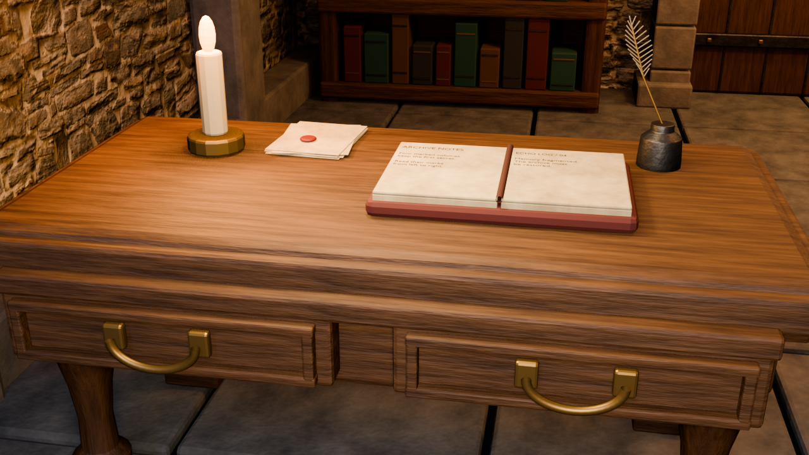 | 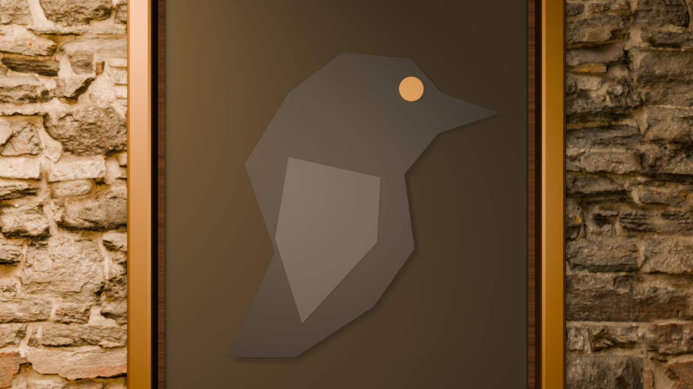 |
| Discover the journal and investigate its clue. | Examine the mysterious mechanism in the frame. |
| **Bookshelf** | **ECHO terminal** |
| 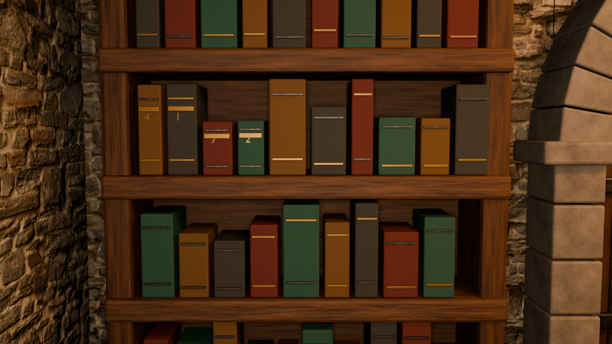 | 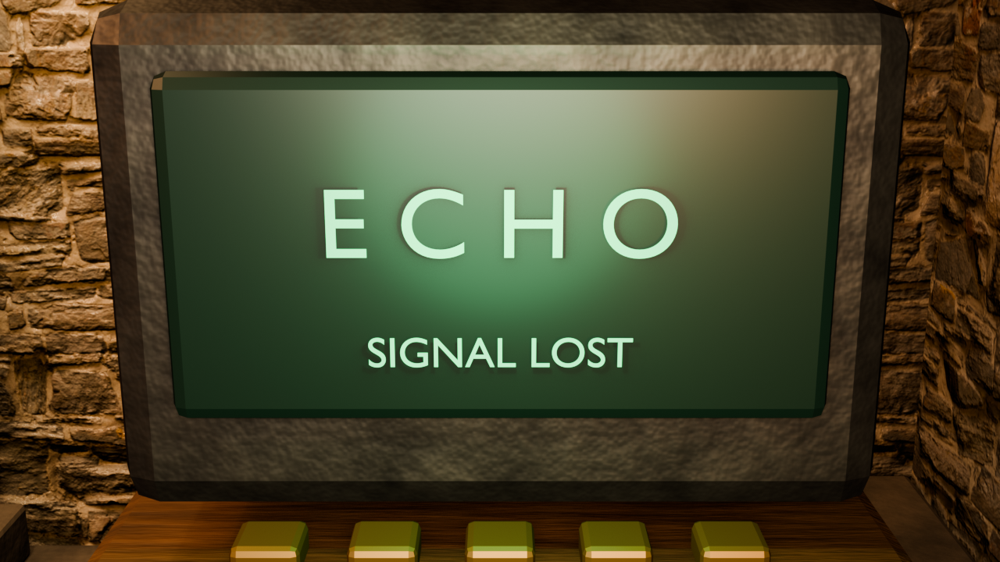 |
| Investigate marked volumes to decipher a combination. | Restore the AI using collected items. |
| **Locked drawer** | **Escape door** |
| 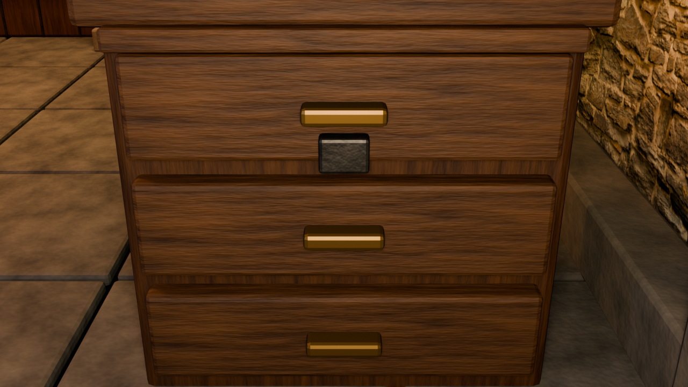 | 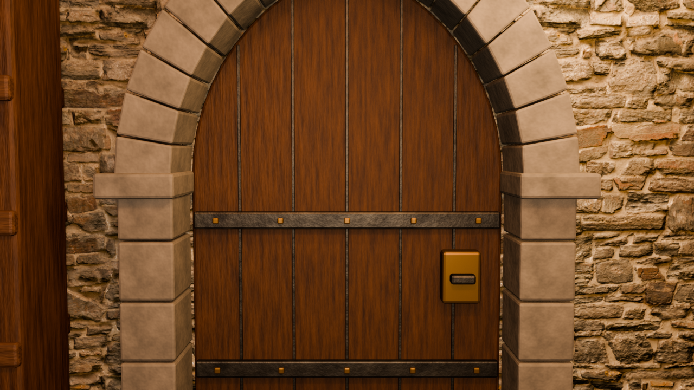 |
| Solve the combination to recover an item. | Complete the required puzzles and unlock the exit. |

## Gameplay and features

- Six interactive room objects, three linked puzzle challenges and a final escape.
- Natural-language interaction through ECHO, powered by Gemini.
- Session-based conversation, inventory, progress indicators and restart.
- Nine original Blender renders that change as the player investigates objects.
- Version 2 has instant local inspection and puzzle controls, so gameplay can continue if the API is unavailable. Optional AI narration adds atmosphere.

Start by typing **"Read the journal on the scientist's desk."** Explore the room, collect the key and access card, restore ECHO and find your way out.

## AI architecture

### Version 1 — LLM-managed baseline

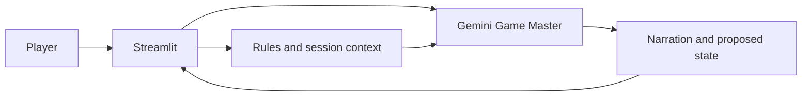

Gemini receives the game rules, player input and recent conversation. It narrates the result and proposes inventory and progress updates. Python applies those updates without checking puzzle dependencies, intentionally illustrating the reliability limitations of an LLM-authoritative design.

### Version 2 — Hybrid AI + deterministic rules

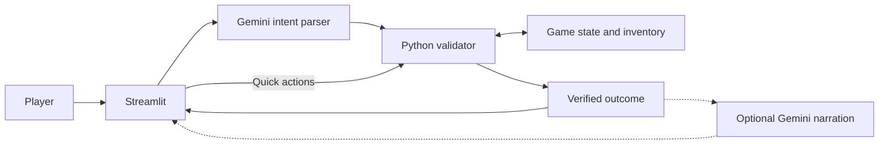

Gemini translates a message into an action. Python checks the action, target, combination and inventory against fixed rules before updating state. The verified outcome controls progress and visual views. Optional AI narration cannot directly change state.

| Capability | V1 | V2 |
| --- | --- | --- |
| Natural-language gameplay | Yes | Yes |
| Inventory and progress | LLM-proposed | Python-authoritative |
| Incorrect code / missing items | LLM judgment | Deterministic rejection |
| Premature escape | May be accepted by LLM | Blocked by required state |
| Visual inspection | Yes | Yes |
| Play without API requests | No complete local path | Quick actions |

## Verified gameplay and tests

The local engine test suite covers normal gameplay, invalid actions, inventory, repeated rewards and five comparative cases using simulated invalid V1 responses. These simulations demonstrate architectural weaknesses, not measured live Gemini failure rates.

<details>
<summary>Show gameplay and security screenshots (contains puzzle spoilers)</summary>

**Successful Version 2 escape**

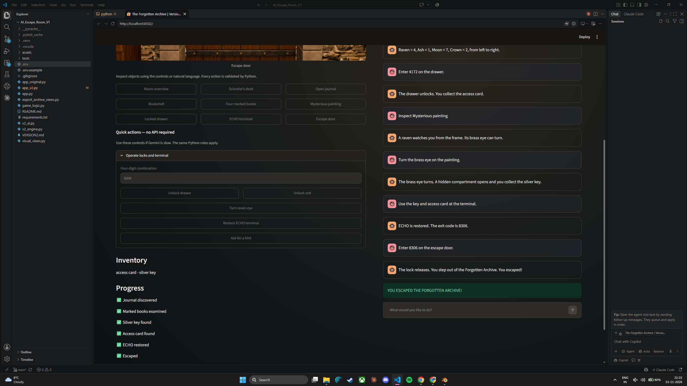

**Premature escape rejected**

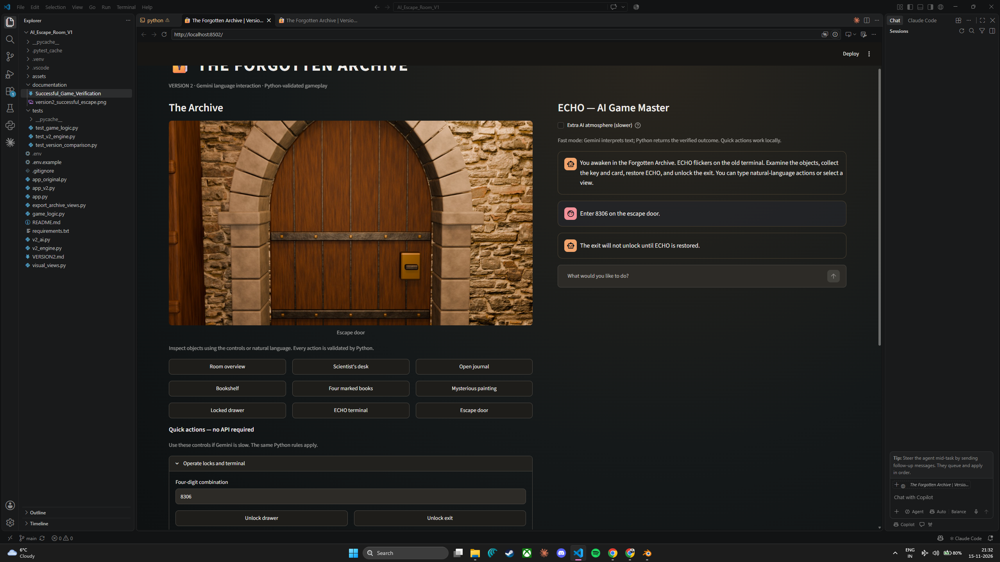

</details>

The screenshots demonstrate a successful local-control playthrough and rejection of an early exit attempt. Live Gemini availability depends on model access and API quota.

## Run locally

Requires Python 3.12 or a compatible installed Python version, and a Gemini API key for chat. Version 2 local controls also work without a key.

```powershell
git clone https://github.com/Koushiksunny44/AI-Escape-Room.git
cd AI-Escape-Room
python -m venv .venv
.\.venv\Scripts\Activate.ps1
python -m pip install -r requirements.txt
Copy-Item .env.example .env
```

Enter your own key in the private `.env` file. Select a Gemini model available to your AI Studio project in `GEMINI_MODEL`. Never commit credentials.

```powershell
python -m streamlit run app_v2.py --server.port 8502
```

For Version 1, run `python -m streamlit run app.py --server.port 8501` in another terminal.

Run the automated tests with `python -m pytest -q`.

## Deploy online

1. Sign in to [Streamlit Community Cloud](https://share.streamlit.io/) with GitHub.
2. Create an app from `Koushiksunny44/AI-Escape-Room`, branch `main`, entrypoint `app_v2.py`. Choose Python 3.12 in Advanced settings.
3. Add the following **root-level** values to the private Secrets field (replace placeholders locally with your own values):

   ```toml
   GEMINI_API_KEY = "your_private_key_here"
   GEMINI_MODEL = "your_accessible_model_id"
   ```

4. Deploy and use the URL assigned by Streamlit. Deploy `app.py` as a second app to demonstrate Version 1 if desired.

Keep API keys out of GitHub and screenshots. Public apps share the owner's API quota; Version 2 quick actions remain usable without Gemini.

## Project files and documentation

| File | Purpose |
| --- | --- |
| [app.py](app.py) | Version 1 Streamlit application |
| [app_v2.py](app_v2.py) | Version 2 Streamlit application |
| [game_logic.py](game_logic.py) | V1 rules and LLM-proposed state |
| [v2_engine.py](v2_engine.py) | Deterministic validation and game state |
| [v2_ai.py](v2_ai.py) | Gemini intent parsing and optional narration |
| [visual_views.py](visual_views.py) | Object inspection images |
| [export_archive_views.py](export_archive_views.py) | Blender camera render automation |
| [tests](tests/) | Automated engine and comparative tests |

- [Final project report (PDF)](documentation/Forgotten_Archive_Report.pdf)
- [Version 1 architecture (PDF)](documentation/Architecture_V1.pdf)
- [Version 2 architecture (PDF)](documentation/Architecture_V2.pdf)
- [Comparative test record](documentation/LIVE_TEST_RESULTS.md)
- [Version 2 technical notes](VERSION2.md)

## Scope and limitations

The visuals are pre-rendered Blender close-ups, not a real-time 3D world. Gemini may misinterpret ambiguous actions or generate inaccurate flavor text; the V2 engine protects state transitions, not every sentence of generated narration. Source code and documentation contain puzzle solutions, so this is an educational demonstration rather than a system for protecting secret answers from people with repository access.

**Asset credits:** Original Blender scene and camera renders; CC0 stone and photographic material sources from [Poly Haven](https://polyhaven.com/). See project documentation for implementation details.
